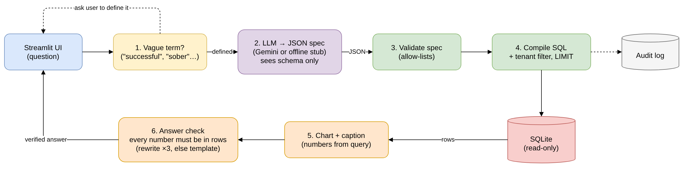
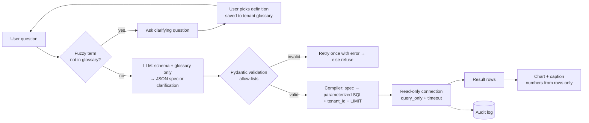

# Task B: Natural language → JSON spec → read-only query → chart

## Setup

**1. Create the environment (conda)**
```bash
conda create -n axon python=3.11 -y
conda activate axon
```

**2. Install dependencies**
```bash
pip install -r requirements.txt
```
I'd normally use [uv](https://docs.astral.sh/uv/) with a lockfile for faster, fully reproducible installs; `requirements.txt` keeps it simple for this submission.

**3. Get a Gemini API key (optional, about 2 minutes)**
1. Go to https://aistudio.google.com/apikey and sign in with a Google account.
2. Click **Create API key** and copy it.
3. Paste it into the **Google API key** box in the app's sidebar, or set it before running:
   - PowerShell: `$env:GOOGLE_API_KEY = "your-key"`
   - macOS/Linux: `export GOOGLE_API_KEY="your-key"`

No key? Everything still runs with the offline stub (a deterministic stand-in for the LLM step).
Never commit the key; it is only read from the sidebar or the environment.

## Run
Put `harbourview_residents.csv` in this folder (or one level up), then:
```bash
streamlit run app.py                           # UI: 6 sample questions, each clarifies a vague term, then answers
python demo.py harbourview_residents.csv       # CLI walkthrough: question types, a clarification turn, safety checks
python run_eval.py harbourview_residents.csv   # regression eval; exits 1 below a 90% pass rate
```
In the UI sidebar, choose **Gemini** or **Offline stub**. For Gemini, pick one or more models from the list your key can access; they are tried in order, falling back to the next on 503 (high demand) or 429 (rate limit) errors. The model only ever sees the schema and saved definitions, never resident records.

## System design


Prototype flow: a vague term gets a clarifying question; otherwise the LLM (schema only) writes a JSON spec, code validates and compiles it to tenant-scoped SQL, SQLite runs it read-only, the chart shows the query's numbers, and an answer check confirms every number in the caption came from the result rows. Editable source: `axon_system_design.drawio`.

## Flow (prototype)


## Design decisions

**1. Structured intermediate.** The model returns `LLMOutput` = either a `Spec` (`metric`, `dimensions`, `filters`, `time_window`, `chart_type`) or a `Clarification`. Pydantic validates it against allow-lists in `core.py`: 6 metrics, 5 dimensions, 5 filter fields, 3 operators. Anything else is rejected, the model gets one retry with the error, then the user gets "can't answer with available data." Each metric is defined once in the semantic layer, *with its denominator*, e.g. `engaged_6m_pct` divides by everyone whose follow-up is due, including lost to follow-up.

**2. Query safety and tenant scoping.** The model never writes SQL. `compile_sql()` builds a parameterized `SELECT` from the validated spec and always injects `tenant_id = ?` from the authenticated session, never from the question. Execution uses a read-only connection (`mode=ro` + `PRAGMA query_only`), `LIMIT 1000`, and a 2-second timeout. In production on MongoDB, the same spec compiles to an aggregation pipeline whose first stage is `$match: {tenant_id}`; the compiler only emits `$match/$group/$project/$sort/$limit`, so `$out`, `$merge` and `$function` can't be produced, and it runs as a read-only DB user with `maxTimeMS`.

**3. Clarification.** A deterministic check runs *before* the LLM: if the question contains a vague term ("successful", "sober", "relapse", "active", "typical", "recent") with no tenant-approved definition, the system asks instead of assuming. Each option is an exact definition (a partial spec), e.g. "sober" offers a labelled **worst case** (engaged ÷ everyone due, 44.7%, n=47) and **best case** (engaged ÷ those reached, 72.4%, n=29). The chosen definition is saved to the tenant glossary and reused; the model is also told to return a clarification for any undefined term. Every answer shows its denominator `n`.

**4. Hallucination guardrails.** The model can only name allow-listed metrics and fields (validated in code). It never produces numbers: figures come from the executed query, and the caption is a template filled from result rows. An **answer check** then verifies that every number in the caption exists in the result rows (values, n, group count); if not, the model rewrites it with the failing numbers fed back, **up to 3 attempts**, and then the system falls back to a template caption built directly from the rows. With Gemini the caption is LLM-written from aggregated rows only (counts and rates, never records); the offline stub always uses the template. The eval includes adversarial cases (asking for staff notes, invented metrics).

**5. Evaluation.** `eval_cases.json` holds NL questions with an expected spec, clarification or rejection. Metrics: spec exact-match rate, clarification precision/recall on fuzzy terms, rejection rate on out-of-scope asks, and (next) result match against hand-computed values. It runs in CI on every prompt or model change and fails below 90%. Next steps: grow it to ~100 cases from real user questions, and track per-question regressions between versions.

**6. PHI handling.** The LLM sees `schema_card()` (column names, enum values, metric definitions), the glossary and the question; never rows. `staff_note` free text is dropped at load, so it can't be queried or sent anywhere. In production, notes that are needed (Task C) are processed by a model running inside Canadian infrastructure, with names, phone numbers and other identifiers redacted first. **Where the model runs:** a self-hosted open model in a Canadian region, or a hosted model only under a PHIPA-compliant agreement with Canadian data residency and no training on inputs. The prototype calls Gemini with schema and synthetic metadata only. Every question, spec, SQL statement and row count is written to an append-only audit log, never result values.

**7. Iteration, versioning, caching.**
- **Iteration:** follow-ups ("now split by discharge reason") edit the previous spec instead of starting over.
- **Versioning:** dashboard specs are stored as versioned JSON documents (spec + schema version + glossary version), so a chart can be reproduced or rolled back.
- **Caching:** results are keyed on hash(tenant + spec), and in production also the data version, so they invalidate on new data.

## Scope and next steps
Built: spec, validation, compiler, read-only execution, clarification turns, Streamlit UI, caption, audit log, eval (11 cases incl. post-clarification specs). Not built (by design, given the time box): MongoDB compiler, UI, multi-turn spec editing, result-level eval, metric definition management UI for directors.
